# Hi, I'm korexil

-DE2910) -BC002D) 

介護福祉を学ぶ学生。ネットが切れても話し続ける相棒を目指しています。<br>
Care work student in Japan, working toward a talking companion that keeps working offline.

<a href="https://github.com/korexil/gpu-duet">
  <picture>
    <source media="(prefers-color-scheme: dark)" srcset="assets/banner-dark.svg">
    
  </picture>
</a>

> **Why offline?** Wi-Fi at home or in a care facility drops, and a companion shouldn't go silent when it does. What's said in someone's room stays in that room. Cloud models still help with work that isn't real-time, like a daily summary for caregivers, written after names are removed on the device.

## Now

**[gpu-duet](https://github.com/korexil/gpu-duet)** — a local LLM (Gemma 4 E4B) and a voice-cloning TTS (Qwen3-TTS 1.7B) share one 8 GB laptop GPU. The LLM pauses after each sentence so the TTS can catch up: first sound of a long answer 6.2 s → 2.1 s, total stutter 4.22 s → 0.17 s. It also works as an offline server for ESP32 voice boards running xiaozhi firmware.

## Upstream

**3 PRs merged into [xiaozhi-esp32-server](https://github.com/xinnan-tech/xiaozhi-esp32-server)** (10k★, open-source ESP32 voice assistant server) — fixes for Japanese conversations:

<details open>
<summary><a href="https://github.com/xinnan-tech/xiaozhi-esp32-server/pull/3413">#3413</a> TTS sentence splitter no longer cuts inside 「」 quotes</summary>

```
before  思わず「わぁ！」って声が出たんだ。 → 思わず「わぁ / 」って声が出たんだ
after   思わず「わぁ！」って声が出たんだ。 (one sentence)
```
</details>

<details>
<summary><a href="https://github.com/xinnan-tech/xiaozhi-esp32-server/pull/3412">#3412</a> SenseVoice Japanese results had spaces between words</summary>

```
before  今日 の こと を 少し 長め に 話し て ください。
after   今日のことを少し長めに話してください。
```
Spaces are removed only between CJK characters; Korean word spacing and `OK Google と言って` stay as they are.
</details>

<details>
<summary><a href="https://github.com/xinnan-tech/xiaozhi-esp32-server/pull/3411">#3411</a> ASR results went into chat history as raw JSON</summary>

```
before  user: {"content": "元気？", "language": "ja", "emotion": "😶"}
after   user: 元気？
```
Small local models tried to answer the JSON instead of the question.
</details>

**Open on [qwen3-tts.cpp](https://github.com/Danmoreng/qwen3-tts.cpp)**

- [#5](https://github.com/Danmoreng/qwen3-tts.cpp/pull/5) Models and voice files under a Japanese-named folder failed to open on Windows
- [#6](https://github.com/Danmoreng/qwen3-tts.cpp/pull/6) C bridge: C++ exceptions no longer kill the host process; bindings can check the struct layout at load time

<picture>
  <source media="(prefers-color-scheme: dark)" srcset="https://raw.githubusercontent.com/korexil/korexil/output/github-snake-dark.svg">
  
</picture>
